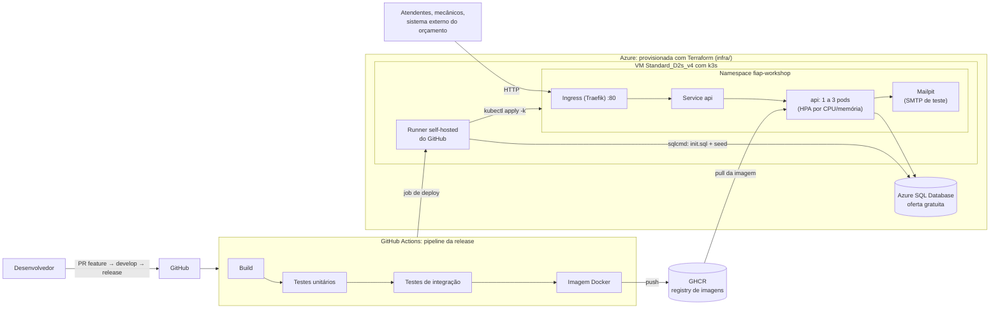

# Fiap.Workshop — Sistema Integrado de Atendimento e Execução de Serviços

Projeto do **Tech Challenge — Fases 1 e 2** da pós-graduação FIAP em Arquitetura de Software (SOAT).

## O desafio

Uma oficina mecânica de médio porte, especializada em manutenção de veículos, enfrenta dificuldades para crescer com qualidade e eficiência. Hoje o atendimento, o diagnóstico, a execução dos serviços e a entrega dos veículos são controlados de forma manual (anotações e planilhas), o que gera erros de priorização no atendimento, falhas no controle de peças e insumos, dificuldade em acompanhar o status dos serviços, perda de histórico de clientes/veículos e um fluxo de orçamento e aprovação ineficiente.

Este repositório é a primeira versão (MVP) do **back-end** de um Sistema Integrado de Atendimento e Execução de Serviços para essa oficina: o objetivo final é permitir que o cliente acompanhe em tempo real o andamento do serviço e autorize reparos adicionais, enquanto a equipe da oficina ganha uma gestão interna — de ordens de serviço, clientes, veículos e peças — eficiente e segura.

O desenvolvimento segue **Domain-Driven Design (DDD)**, com atenção a boas práticas de qualidade de software e segurança: arquitetura em camadas, testes automatizados, autenticação JWT e validação de dados sensíveis (CPF/CNPJ, placa de veículo).

### Fase 2: objetivos

Com o aumento da demanda, a oficina precisa de uma aplicação **escalável, com provisionamento e deploy automatizados**. A Fase 2 evolui o MVP em três frentes:

- **APIs novas e alteradas**: consulta de status da OS, webhook para o sistema externo informar a aprovação ou recusa do orçamento pelo cliente, listagem de OS ordenada por prioridade de status (sem as finalizadas e entregues) e notificação por e-mail a cada mudança de status.
- **Infraestrutura como código**: VM com Kubernetes (k3s) e banco Azure SQL provisionados com **Terraform** na Azure.
- **Orquestração e entrega contínua**: manifestos Kubernetes com **HPA** (escala automática por CPU/memória) e pipeline de **CI/CD** que testa, gera a imagem e faz o deploy no cluster a cada merge na branch `release`.

Detalhes técnicos e o histórico de decisões de cada ticket estão em [`CONTEXT.md`](CONTEXT.md).

## Vídeo demonstrativo (Fase 2)

**Link: <https://youtu.be/8Ne0b6VGG2g>**

Até 15 minutos, com a aplicação no ar na Azure: arquitetura, infraestrutura com Terraform, execução do pipeline de CI/CD até o deploy no cluster, consumo das APIs pelo Swagger e escala automática do HPA sob carga. O roteiro está em [`docs/entrega-fase-2/roteiro-video.md`](docs/entrega-fase-2/roteiro-video.md).

## Sumário

- [O desafio](#o-desafio)
- [Vídeo demonstrativo (Fase 2)](#vídeo-demonstrativo-fase-2)
- [Arquitetura](#arquitetura)
- [Arquitetura de implantação (Fase 2)](#arquitetura-de-implantação-fase-2)
- [Stack técnica](#stack-técnica)
- [O que já está implementado](#o-que-já-está-implementado)
- [Qualidade e entrega](#qualidade-e-entrega)
- [Como rodar localmente](#como-rodar-localmente)
- [Rodando em Kubernetes (local, k3d)](#rodando-em-kubernetes-local-k3d)
- [Infraestrutura na Azure (Terraform)](#infraestrutura-na-azure-terraform)
- [CI/CD](#cicd)
- [Rodando os testes](#rodando-os-testes)
- [Documentação da API (Swagger)](#documentação-da-api-swagger)
- [Autenticação](#autenticação)
- [Estrutura do repositório](#estrutura-do-repositório)

## Arquitetura

Clean Architecture em camadas (monolito, conforme requisito técnico do desafio):

```
Domain          →  entidades, value objects, eventos de domínio — zero dependências externas
Application     →  use cases, boundaries (Input/Output), interfaces (portas)
Infrastructure  →  EF Core, repositórios, serviços concretos (JWT, hashing, dispatcher de eventos)
Api             →  Minimal APIs, composição de DI, validadores, mapeadores HTTP ↔ Application
```

Regra de dependência: `Domain` não referencia nada; `Application` referencia `Domain`; `Infrastructure` referencia `Application`; `Api` referencia `Infrastructure` (e, transitivamente, todo o resto).

## Arquitetura de implantação (Fase 2)



**Componentes da aplicação**: a api (.NET 10, camadas acima) roda em 1 a 3 pods, conforme a carga; o Mailpit captura os e-mails de mudança de status da OS; o banco é o Azure SQL, fora do cluster.

**Infraestrutura provisionada**: uma VM Linux com k3s (Kubernetes leve, que já traz o Ingress Traefik e o metrics-server usado pelo HPA), rede e firewall (HTTP aberto, SSH só para o IP do administrador) e o Azure SQL Database com pausa automática. Ver [Infraestrutura na Azure](#infraestrutura-na-azure-terraform).

**Fluxo de deploy**: um merge na `release` dispara o pipeline. Build e testes rodam em máquinas do GitHub; a imagem vai para o GHCR; o job de deploy roda num runner instalado na própria VM, aplica o schema no banco, aplica os manifestos e confere a aplicação no ar. Ver [CI/CD](#cicd).

## Stack técnica

| Categoria | Escolha |
|---|---|
| Runtime | .NET 10 / C# `latest` |
| API | Minimal APIs + `Asp.Versioning` (versionamento por segmento de URL, `/api/v1/...`) |
| Documentação | `Microsoft.AspNetCore.OpenApi` + Swagger UI (`/swagger`) |
| Autenticação | JWT Bearer, policies `AdminOnly` / `AttendantOnly` / `MechanicOnly` |
| Hash de senha | BCrypt.Net-Next (work factor 12) |
| Persistência | EF Core 10 + **SQL Server** |
| Validação | FluentValidation |
| Logging | Serilog (console + request logging) |
| Testes | xUnit, FluentAssertions, Moq, AutoFixture |

**Por que SQL Server?** O domínio da oficina é fortemente relacional (OS ⇄ cliente ⇄ veículo ⇄ itens de serviço/peça, com integridade referencial e transações que precisam ser consistentes — ex.: baixa de estoque ao aprovar uma OS). SQL Server foi escolhido por ser um banco relacional maduro, com bom suporte a migrations via EF Core e por já estar configurado no ambiente de containers do time.

## O que já está implementado

- **Usuários**: cadastro (`POST /api/v1/users`, `AdminOnly`), login (`POST /api/v1/auth/login`), renovação de sessão por refresh token com rotação (`POST /api/v1/auth/refresh`), logout (`POST /api/v1/auth/logout`), listagem, atualização de perfil, troca de senha (self-service, encerra todas as sessões do usuário) e remoção.
- **Clientes**: CRUD completo — criação com validação de CPF/CNPJ, consulta por id, listagem, atualização (documento é imutável após o cadastro) e remoção (bloqueada com `400` se o cliente tiver veículos vinculados).
- **Veículos**: CRUD completo — criação com validação de placa (Mercosul e padrão antigo) vinculada a um cliente existente, consulta por id, listagem, atualização (placa imutável) e remoção (bloqueada com `400` se houver OS vinculada).
- **Serviços** (catálogo): CRUD completo — criação, consulta por id, listagem, atualização (código imutável; desativar um serviço o impede de entrar em orçamentos novos) e remoção (bloqueada com `400` se o serviço já tiver sido usado em alguma OS). O tempo estimado de execução (`EstimatedDuration`) é uma média incremental que se autoatualiza a cada OS concluída, com `ExecutionCount` exposto para indicar quantas amostras embasam o número — é como o desafio pede o "monitoramento do tempo médio de execução dos serviços".
- **Peças/Insumos** (catálogo + estoque): CRUD completo — criação, consulta por id, listagem, atualização (código e quantidades de estoque ficam de fora: estoque só muda pelo fluxo de reserva/orçamento) e remoção (bloqueada com `400` se a peça já tiver sido usada em alguma OS). Desativar uma peça a impede de entrar em orçamentos novos.
- **Ordem de Serviço**: máquina de estados completa — `Recebida` → `Em diagnóstico` → `Aguardando aprovação` → (`Em execução` → `Finalizada` | `Cancelada`) → `Entregue`, com orçamento calculado automaticamente a partir dos serviços/peças informados, reserva e baixa real de estoque, e histórico de status registrado a cada transição. A aprovação ou recusa do orçamento é decisão do cliente e chega por um webhook chamado por um sistema externo (`POST /api/v1/webhooks/budget-decisions`, ver "Webhook de decisão do orçamento"). Listagem (`GET /api/v1/service-orders`) e detalhamento por id (`GET /api/v1/service-orders/{id}`) para gestão administrativa. Consulta pública e anônima da OS pelo cliente via CPF/CNPJ + placa (`GET /api/v1/service-orders/lookup`), sem vazar existência de cadastro.
- **Fase 2**:
  - Consulta de status da OS: `GET /api/v1/service-orders/{id}/status`.
  - Listagem de OS (`GET /api/v1/service-orders`) ordenada por prioridade (`Em execução` > `Aguardando aprovação` > `Em diagnóstico` > `Recebida`, mais antigas primeiro), sem as OS `Finalizada` e `Entregue`. A `Cancelada` aparece por último até o carro ser retirado.
  - Webhook de aprovação/recusa do orçamento, autenticado por API key (ver "Webhook de decisão do orçamento").
  - E-mail ao cliente a cada mudança de status da OS (evento de domínio + MailKit; em dev e no cluster, capturado pelo Mailpit).
  - Health checks `GET /health/live` e `GET /health/ready` (este consulta o banco), usados pelas probes do Kubernetes.
  - **Abertura de OS mantida com `CustomerId` + `VehicleId`**: serviços e peças entram no orçamento, durante o diagnóstico, e não na abertura. Decisão de negócio: o orçamento reserva estoque, e só depois do diagnóstico do mecânico se sabe o que será usado; cliente e veículo já têm cadastro próprio.
- Schema de banco (`db/init.sql`) aplicado por um serviço de init do `docker-compose` antes da API subir — sem migration em runtime. Inclui seed idempotente do primeiro usuário Admin (bootstrap).
- Testes unitários (Domain + Application) e projeto de testes de integração com SQL Server real via `docker-compose.tests.yml`, cobrindo os fluxos acima.

Ver [`CONTEXT.md`](CONTEXT.md) para o desenho técnico completo (camada por camada) e o histórico de decisões de cada ticket fechado.

## Qualidade e entrega

Itens de qualidade/entrega exigidos pelo desafio, todos fechados:

- **Cobertura de testes**: confirmado via SonarQube Cloud — **97,5%** de cobertura em `Domain`/`Application` (Fase 1: 97,3%), acima da meta mínima de 80%. Na Fase 2 o SonarQube Cloud mostra **0 bugs, 0 vulnerabilidades e 0% de duplicação**.
- **Relatório de análise de vulnerabilidades (SAST)**: CodeQL + SonarQube Cloud rodam no CI; os achados de severidade `medium` (log forging e exposição de dado sensível em log) foram corrigidos — ver [`docs/entrega-fase-1/entrega-fase-1.pdf`](docs/entrega-fase-1/entrega-fase-1.pdf) para o relatório completo.
- **Documentação DDD** (Event Storming, diagramas, linguagem ubíqua) dos fluxos de OS e de gestão de peças/insumos — feita no Miro, [link no fim deste documento](#estrutura-do-repositório).

### Refatoração (Fase 2)

- **Camadas revisadas**: `Domain` não depende de nada externo; `Application` não usa EF Core nem ASP.NET; a `Api` só usa a `Infrastructure` na composição de dependências.
- **Transições da Ordem de Serviço**: a validação do status de origem, repetida nas seis transições, virou uma guarda única (`EnsureCanTransitionTo`); cada transição declara de quais status pode partir.
- **Usuário de sistema protegido**: o usuário que registra as decisões do webhook não pode ser removido nem editado pela gestão de usuários.
- **Erros de requisição**: JSON malformado responde `400` (antes `500`), e o log de requisições passou a registrar o status final da resposta (falhas de regra de negócio apareciam como `500` no log).
- **Code smells**: 10 dos 17 apontados pelo SonarQube Cloud corrigidos; os 7 restantes são mantidos de propósito (construtores de entidades que reconstroem o estado vindo do banco, e a igualdade por valor dos Value Objects) — justificativa em [`CONTEXT.md`](CONTEXT.md) §8.
- **Testes**: um único framework de mock (Moq); testes unitários e de integração para cada regra nova.

O histórico de decisões e o desenho detalhado do que já existe estão em [`CONTEXT.md`](CONTEXT.md).

## Como rodar localmente

Pré-requisitos: [Docker](https://www.docker.com/) e Docker Compose.

1. Copie o arquivo de variáveis de ambiente de exemplo:

   ```bash
   cp .env.example .env
   ```

2. Suba a aplicação e o banco de dados:

   ```bash
   docker compose up -d --build
   ```

3. A API estará disponível em `http://localhost:8080` (porta configurável via `API_PORT` no `.env`). O schema do banco é criado por um serviço de init (`sqlserver-init`) rodando `db/init.sql` antes da API subir — inclui o seed de um usuário Admin de bootstrap:

   | Campo | Valor |
   |---|---|
   | Email | `admin@admin.com` |
   | Senha | `Admin@123` |

   Use essas credenciais em `POST /api/v1/auth/login` pra obter um access token JWT com role `Admin` (campo `result.accessToken` da resposta, ver "Autenticação") e conseguir chamar endpoints protegidos (ex.: `POST /api/v1/users`, pra cadastrar os demais usuários). Troque essa senha em qualquer ambiente que não seja local/dev.

4. Logo em seguida, outro serviço (`sqlserver-seed-demo`) popula o banco com dados de demonstração — 2 usuários extras, 4 clientes, 5 veículos, catálogo de serviços/peças com estoque e 6 Ordens de Serviço cobrindo cada status da máquina de estados, com histórico completo (ver `db/seed-demo.sql`). Não é aplicado nos testes de integração, só neste ambiente. Credenciais dos usuários extras (senha `Demo@123` pros dois):

   | Papel | Email |
   |---|---|
   | Attendant | `atendente@oficina.com` |
   | Mechanic | `mecanico@oficina.com` |

5. Para derrubar o ambiente:

   ```bash
   docker compose down
   ```

### Rodando sem Docker (.NET SDK local)

Requer .NET SDK 10 e uma instância de SQL Server acessível (ajuste `ConnectionStrings:DefaultConnection` em `src/Fiap.Workshop.Api/appsettings.json` ou via variável de ambiente `ConnectionStrings__DefaultConnection`; o valor padrão já aponta para `localhost,1433`):

```bash
dotnet restore Fiap.Workshop.slnx
dotnet run --project src/Fiap.Workshop.Api
```

## Rodando em Kubernetes (local, k3d)

Os manifestos ficam em [`k8s/`](k8s/), organizados com Kustomize:

```
k8s/
  base/            # comum a qualquer ambiente: namespace, api, Mailpit
  overlays/local/  # cluster local: SQL Server dentro do cluster, Job que prepara o banco, Secrets, deploy.sh
  overlays/azure/  # VM na Azure: banco no Azure SQL, imagem do GHCR; aplicado pelo pipeline (ver CI/CD)
```

| Recurso | Papel |
|---|---|
| `Deployment` `api` | A aplicação. Roda como usuário sem privilégio, reserva 100m de CPU / 256Mi de memória (limite 500m / 512Mi) |
| `Service` `api` + `Ingress` | Distribui as requisições entre os pods da api; o Ingress (Traefik, embutido no k3s) é a porta de entrada do cluster |
| `HorizontalPodAutoscaler` `api` | Mantém de 1 a 3 pods: escala quando a CPU média passa de 70% do reservado ou a memória média passa de 400Mi |
| `ConfigMap` `api-config` / `Secret` `api-secrets` | Configuração da api; senha do banco, chave do JWT e chave do webhook ficam no Secret |
| `Deployment` `mailpit` | Servidor SMTP de teste: captura os e-mails de mudança de status da OS |
| `StatefulSet` `sqlserver` (só local) | Banco de dados com disco próprio: os dados sobrevivem a reinícios do pod |
| `Job` `db-init` (só local) | Aplica `db/init.sql` e `db/seed-demo.sql`, os mesmos scripts do docker-compose |

As verificações de saúde usam os endpoints de health check: `startupProbe` em `/health/ready` (consulta o banco, só enquanto o pod sobe), `livenessProbe` e `readinessProbe` em `/health/live`.

**Pré-requisitos**: [Docker](https://www.docker.com/), [k3d](https://k3d.io/) v5+ e `kubectl` (já vem com o Docker Desktop). No Windows, rode os comandos abaixo no **Git Bash**, porque o `deploy.sh` é um script de shell.

### 1. Subir o cluster e a aplicação

1. Crie os arquivos de segredo a partir dos exemplos (ficam fora do git):

   ```bash
   cp k8s/overlays/local/api-secrets.env.example k8s/overlays/local/api-secrets.env
   cp k8s/overlays/local/sqlserver-secrets.env.example k8s/overlays/local/sqlserver-secrets.env
   ```

2. Crie o cluster:

   ```bash
   k3d cluster create fiap-workshop -p "8081:80@loadbalancer" --api-port 127.0.0.1:6550
   kubectl get nodes   # esperado: k3d-fiap-workshop-server-0   Ready
   ```

   - `-p "8081:80@loadbalancer"`: a api passa a responder em `http://localhost:8081`.
   - `--api-port 127.0.0.1:6550`: porta por onde o `kubectl` fala com o cluster. Sem ela, no Windows o `kubectl` pode ficar sem conseguir conectar (`Unable to connect to the server`).

3. Gere a imagem e aplique os manifestos:

   ```bash
   sh k8s/overlays/local/deploy.sh
   ```

   O script gera a imagem da api, copia a imagem para dentro do cluster, aplica os manifestos, roda o Job que prepara o banco e espera a api ficar pronta (`deployment "api" successfully rolled out`).

   Na primeira vez, o cluster ainda precisa baixar a imagem do SQL Server (~2,3 GB), e o script pode encerrar por `timed out`. Acompanhe com `kubectl -n fiap-workshop get pods -w` até todos os pods ficarem `Running 1/1` e o `db-init` ficar `Completed`, e rode o script de novo.

4. Confira que está tudo no ar, com **1** pod da api:

   ```bash
   kubectl -n fiap-workshop get all
   curl http://localhost:8081/health/ready   # esperado: Healthy
   ```

   Swagger em `http://localhost:8081/swagger`. As credenciais são as mesmas do docker-compose (`admin@admin.com` / `Admin@123`, `atendente@oficina.com` e `mecanico@oficina.com` / `Demo@123`).

5. Para ver os e-mails enviados pela api (o Mailpit não fica exposto fora do cluster):

   ```bash
   kubectl -n fiap-workshop port-forward svc/mailpit 8025:8025   # abra http://localhost:8025
   ```

### 2. Testar a escala automática (HPA)

Deixe dois terminais abertos acompanhando o cluster (`-w` atualiza sozinho; `Ctrl+C` para sair):

```bash
kubectl -n fiap-workshop get hpa api -w            # uso atual/alvo e número de réplicas
kubectl -n fiap-workshop get pods -l app=api -w    # pods da api nascendo e sendo removidos
```

Em um terceiro terminal, gere carga com o [k6](https://k6.io/) (via Docker, sem instalar). O script [`tests/load/hpa-load.js`](tests/load/hpa-load.js) simula 30 usuários consultando a listagem de OS sem pausa por ~4 minutos:

```bash
MSYS_NO_PATHCONV=1 docker run --rm -t -p 5665:5665 -v "$(pwd -W)/tests/load:/scripts" \
  -e K6_WEB_DASHBOARD=true -e K6_WEB_DASHBOARD_HOST=0.0.0.0 \
  grafana/k6 run /scripts/hpa-load.js
```

No Linux/macOS, remova o `MSYS_NO_PATHCONV=1` e troque `$(pwd -W)` por `$(pwd)`. Esse ajuste só existe porque o Git Bash converte caminhos como `/scripts` para caminhos do Windows. Durante o teste, o painel do k6 fica em `http://localhost:5665`.

O que deve acontecer:

| Momento | HPA | Pods da api |
|---|---|---|
| Antes da carga | `cpu: ~1%/70%`, 1 réplica | 1 pod `Running 1/1` |
| ~60–90 s de carga | CPU bem acima de 70%; réplicas → **3** | 2 pods novos: `Pending` → `ContainerCreating` → `Running 1/1` |
| Fim da carga | CPU volta a ~1%, ainda 3 réplicas | 3 pods |
| ~5 min depois | réplicas → **1** | 2 pods `Terminating` |

- O HPA espera a CPU ficar acima do alvo por 60 s antes de criar pods, para não escalar com o pico de CPU do arranque da aplicação. Para remover pods, espera 5 minutos abaixo do alvo, para não ficar criando e destruindo pods a cada oscilação.
- `kubectl -n fiap-workshop describe hpa api` mostra, em `Events`, o motivo de cada decisão (ex.: `New size: 3; reason: cpu resource utilization ... above target`).
- No resumo final do k6, `http_req_failed` deve ficar em `0.00%`: nenhuma requisição falha enquanto os pods novos entram.
- Se a CPU não subir (a api passa o tempo esperando o banco, caso do Azure SQL gratuito), use [`tests/load/hpa-login-load.js`](tests/load/hpa-login-load.js) no lugar do `hpa-load.js`: 10 usuários fazendo login sem pausa. A conferência da senha com BCrypt gasta CPU na api e quase não usa o banco.

### 3. Testar a reposição de um pod

O Deployment garante que a quantidade de pods definida pelo HPA exista. Se um pod morre, outro é criado no lugar. Para ver o efeito do ponto de vista de quem usa a api, deixe este laço rodando (`000` = sem resposta):

```bash
while true; do echo "$(date +%T) $(curl -s -o /dev/null -m 2 -w '%{http_code}' http://localhost:8081/health/live)"; sleep 0.5; done
```

E, em outro terminal, remova um pod da api:

```bash
kubectl -n fiap-workshop get pods -l app=api
kubectl -n fiap-workshop delete pod <nome-do-pod>
```

Um pod novo, com outro nome, aparece em seguida e fica `Running 1/1` em ~15–30 s.
- **Com 1 pod**: o laço mostra algumas falhas até o substituto ficar pronto.
- **Com 3 pods** (remova um durante o teste de carga): o laço continua em `200`, porque o Service manda as requisições para os pods restantes.

Removendo o banco (`kubectl -n fiap-workshop delete pod sqlserver-0`), ele volta com o mesmo nome e com os dados intactos, porque o disco fica separado do pod.

### 4. Desligar

```bash
k3d cluster stop fiap-workshop     # pausa, mantendo os dados (k3d cluster start fiap-workshop retoma)
k3d cluster delete fiap-workshop   # apaga o cluster e os dados
```

## Infraestrutura na Azure (Terraform)

Os scripts ficam em [`infra/`](infra/). O estado do Terraform fica na máquina de quem aplica (fora do git): a infraestrutura é criada para a demonstração e destruída depois.

### O que é criado

| Recurso | Detalhe |
|---|---|
| Resource group `fiap-workshop-rg` | Agrupa tudo; apagar o grupo apaga todos os recursos |
| Rede virtual + sub-rede | `10.0.0.0/16` / `10.0.1.0/24` |
| Network security group (associado à sub-rede) | Porta 80 aberta para a internet; porta 22 (SSH) só para o IP do administrador. A API do Kubernetes (6443) **não** é exposta |
| IP público estático + interface de rede | Endereço da aplicação: `http://<ip>/` |
| VM `Standard_D2s_v4` (2 vCPU, 8 GB, Ubuntu 24.04) | k3s instalado pelo cloud-init no primeiro boot, mesma versão do k3d local |
| Azure SQL Server + database `Fiap_Workshop` | **Oferta gratuita** (serverless, pausa sozinho quando ocioso; se a cota mensal acabar, pausa em vez de cobrar) |
| Duas regras de firewall do Azure SQL | Liberam só o IP público da VM e o IP do administrador |
| Senhas (`random_password`) | Senha do banco, chave do JWT e chave do webhook, geradas pelo Terraform e lidas com `terraform output` |

Arquivos: [`main.tf`](infra/main.tf) (rede e VM), [`database.tf`](infra/database.tf) (Azure SQL), [`secrets.tf`](infra/secrets.tf) (chaves da aplicação), [`cloud-init.yaml`](infra/cloud-init.yaml) (instalação do k3s), [`variables.tf`](infra/variables.tf), [`outputs.tf`](infra/outputs.tf) e [`versions.tf`](infra/versions.tf) (providers `azurerm`, `azapi` e `random`).

**Variáveis** (em `terraform.tfvars`, fora do git; modelo em [`terraform.tfvars.example`](infra/terraform.tfvars.example)):

| Variável | Obrigatória | Padrão | Uso |
|---|---|---|---|
| `subscription_id` | sim | — | Assinatura Azure (`az account show --query id -o tsv`) |
| `admin_ip` | sim | — | Seu IP público: único liberado para SSH e para o banco |
| `vm_size` | sim | — | `Standard_D2s_v4`; precisa de ≥ 4 GB e cota na família |
| `location` | não | `brazilsouth` | Região |
| `prefix` | não | `fiap-workshop` | Prefixo do nome dos recursos |
| `admin_username` | não | `azureuser` | Usuário Linux da VM |
| `ssh_public_key_path` | não | `~/.ssh/fiap-workshop-azure.pub` | Chave pública instalada na VM |
| `k3s_version` | não | `v1.35.5+k3s1` | Mesma versão do k3d local |
| `database_name` | não | `Fiap_Workshop` | Nome do banco |

**Saídas** (`terraform output`; as sensíveis só com `-raw <nome>`): `vm_public_ip`, `ssh_command`, `sql_server_fqdn`, `sql_admin_login`, `sql_admin_password` (sensível), `connection_string` (sensível), `jwt_secret_key` (sensível) e `webhook_api_key` (sensível).

**Por que essas escolhas**: a assinatura Azure for Students só permite algumas regiões (`brazilsouth` é uma delas) e não oferece a série B no Brasil, por isso a `D2s_v4`. O banco é criado pelo provider `azapi`, porque o `azurerm` não expõe a oferta gratuita do Azure SQL.

### Como aplicar

Pré-requisitos: [Terraform](https://developer.hashicorp.com/terraform/install) ≥ 1.6, [Azure CLI](https://learn.microsoft.com/cli/azure/install-azure-cli), [GitHub CLI](https://cli.github.com/) e uma assinatura Azure.

1. Entre na Azure e, se a assinatura for nova, registre os serviços usados (uma vez só):

   ```bash
   az login
   az provider register -n Microsoft.Compute --wait
   az provider register -n Microsoft.Network --wait
   az provider register -n Microsoft.Sql --wait
   ```

2. Crie a chave SSH da VM e o arquivo de variáveis:

   ```bash
   ssh-keygen -t ed25519 -f ~/.ssh/fiap-workshop-azure -N ""
   cd infra
   cp terraform.tfvars.example terraform.tfvars   # preencha subscription_id, admin_ip (seu IP público) e vm_size
   ```

3. Provisione (~5 min):

   ```bash
   terraform init
   terraform plan -out=tfplan     # mostra o que será criado, sem criar nada
   terraform apply tfplan
   terraform output               # IP da VM, comando SSH, endereço do banco
   ```

4. Registre a VM como runner do GitHub Actions (instala o runner como serviço e os pré-requisitos do deploy):

   ```bash
   sh scripts/register-runner.sh
   ```

5. Grave os segredos do pipeline no repositório e ligue o deploy (PowerShell, na pasta `infra`):

   ```powershell
   $repo = "HumbertoVitalino/fiap-postgraduated-workshop"
   $map = @{ SQL_SERVER = "sql_server_fqdn"; SQL_USER = "sql_admin_login"; SQL_PASSWORD = "sql_admin_password"; JWT_SECRET_KEY = "jwt_secret_key"; WEBHOOK_API_KEY = "webhook_api_key" }
   foreach ($k in $map.Keys) { gh secret set $k --repo $repo --body (terraform output -raw $map[$k]) }
   gh variable set DEPLOY_ENABLED --repo $repo --body "true"
   ```

6. Faça o deploy: um merge na `release`, ou *Actions → CI/CD - Release → Run workflow*. Depois:
   - API: `http://<ip>/swagger`
   - Chave do webhook (header `X-Api-Key`): `terraform output -raw webhook_api_key`
   - E-mails (Mailpit, não exposto): `ssh -i ~/.ssh/fiap-workshop-azure -L 8025:localhost:8025 azureuser@<ip> kubectl -n fiap-workshop port-forward svc/mailpit 8025:8025` e abrir `http://localhost:8025`

### Como destruir

```bash
gh variable set DEPLOY_ENABLED --body "false"   # o pipeline para de tentar o deploy
terraform destroy
```

O runner fica *offline* no GitHub depois do `destroy`; remova-o em *Settings → Actions → Runners*.

Custo: só a VM e o IP público cobram (~US$ 3–4 por dia ligados); o banco fica na cota gratuita. Para pausar sem destruir: `az vm deallocate -g fiap-workshop-rg -n fiap-workshop-vm` (e `az vm start` para voltar; o IP não muda).

## CI/CD

Pipelines em [`.github/workflows/`](.github/workflows/):

| Workflow | Quando roda | O que faz |
|---|---|---|
| `ci-feature.yml` | push em `feature/**` | Build, testes unitários, de integração e funcionais |
| `ci-develop.yml` | push na `develop` | O mesmo + abre o PR `develop → release` |
| **`ci-release.yml`** | push na `release` (ou manual) | **CI/CD completo**, abaixo |
| `codeql.yml` | push e PR para a `release`, e semanal | Análise de segurança (SAST) |

Jobs do `ci-release.yml`:

1. **Build** da solução.
2. **Testes unitários** e **testes de integração** (SQL Server em container, na própria máquina do GitHub). Em paralelo, análise no **SonarQube Cloud**.
3. **Imagem Docker**: build e push para o GHCR (`ghcr.io/humbertovitalino/fiap-postgraduated-workshop`), com a tag do commit e `latest`.
4. **Deploy**, no runner self-hosted da VM:
   - espera o Azure SQL sair da pausa e aplica `db/init.sql` + `db/seed-demo.sql` (idempotentes) com `sqlcmd`: **deploy do banco**;
   - monta o Secret da api a partir dos GitHub Secrets e troca a tag da imagem pela do commit;
   - `kubectl apply -k k8s/overlays/azure` e espera o rollout: **aplicação dos manifestos**;
   - smoke test: `/health/ready` e login.

O job de deploy só roda com a variável de repositório `DEPLOY_ENABLED=true`, porque a VM só existe enquanto a infraestrutura está provisionada. Segredos usados: `SQL_SERVER`, `SQL_USER`, `SQL_PASSWORD`, `JWT_SECRET_KEY`, `WEBHOOK_API_KEY` (ver passo 5 acima).

**Por que um runner na VM**: o deploy roda dentro do cluster, sem expor a API do Kubernetes na internet e sem credenciais da Azure no GitHub. O Terraform não roda no pipeline: provisionar a infraestrutura (uma vez) e fazer deploy da aplicação (a cada merge) são ciclos diferentes.

## Rodando os testes

**Testes unitários** (Domain + Application, sem dependências externas):

```bash
dotnet test tests/Fiap.Workshop.UnitTests
```

**Testes de integração** (sobem um SQL Server dedicado em container):

```bash
docker compose -f docker-compose.tests.yml up -d
dotnet test tests/Fiap.Workshop.IntegrationTests
```

**Testes funcionais**: projeto `tests/Fiap.Workshop.FunctionalTests` existe no scaffold, mas ainda não tem testes escritos.

## Documentação da API (Swagger)

O Swagger é a collection completa das APIs: lista todas as rotas, com os corpos de requisição e as respostas, e permite chamá-las direto do navegador (botão *Authorize* para o token JWT). Com a aplicação em execução:

| Ambiente | Swagger |
|---|---|
| docker-compose | `http://localhost:8080/swagger` |
| k3d local | `http://localhost:8081/swagger` |
| Azure | `http://<ip da VM>/swagger` (`terraform output vm_public_ip`) |

O documento OpenAPI puro fica em `/openapi/v1.json` e pode ser importado no Postman (*Import → Link*).

**Collection sem precisar da aplicação no ar**: cópia do mesmo documento em [`docs/api/openapi.json`](docs/api/openapi.json). Para importar no Postman: *Import → Link* com o endereço *raw* do arquivo no GitHub (`https://raw.githubusercontent.com/HumbertoVitalino/fiap-postgraduated-workshop/release/docs/api/openapi.json`), ou *Import → File*. O servidor configurado é o do docker-compose (`http://localhost:8080`). Ao mudar uma rota, gere a cópia de novo com a api do docker-compose no ar: `curl -s http://localhost:8080/openapi/v1.json -o docs/api/openapi.json`.

## Autenticação

`POST /api/v1/users` exige um token JWT com role `Admin` (policy `AdminOnly`). Obtenha um token via `POST /api/v1/auth/login`, usando o usuário Admin de bootstrap (`admin@admin.com` / `Admin@123`, ver "Como rodar localmente") — troque essa senha em qualquer ambiente que não seja local/dev.

A autenticação usa um par de tokens:

| Token | Formato | Validade padrão | Uso |
|---|---|---|---|
| `accessToken` | JWT (HS256) | 15 min (`Jwt__ExpirationInMinutes`) | Header `Authorization: Bearer <accessToken>` em toda rota protegida |
| `refreshToken` | String aleatória opaca (só o hash SHA-256 fica no banco) | 7 dias (`Jwt__RefreshTokenExpirationInDays`) | Só em `POST /api/v1/auth/refresh` e `POST /api/v1/auth/logout` |

Fluxo:

1. **Login** — `POST /api/v1/auth/login` devolve `{ "result": { "accessToken": "...", "refreshToken": "..." } }`.
2. **Renovação** — quando uma rota protegida responder `401`, chame `POST /api/v1/auth/refresh` com `{ "correlationId": "...", "refreshToken": "..." }` (sem header `Authorization`). A resposta traz um par **novo**: o refresh token usado é revogado na hora (rotação) e não funciona uma segunda vez. Token inválido, expirado ou já usado → `401`.
3. **Logout** — `POST /api/v1/auth/logout` com o mesmo corpo revoga o refresh token (`204`, idempotente). Descarte os dois tokens no cliente.

Trocar a senha (`PATCH /api/v1/users/{id}/password`) e remover o usuário encerram **todas** as sessões dele. Limitação conhecida: um access token já emitido continua válido até expirar (no máximo 15 min), mesmo após logout ou troca de senha — é o comportamento normal de JWT, que não consulta o banco a cada requisição.

O `CorrelationId` esperado pela API vai no corpo da requisição (campo `correlationId`), não em um header — é um padrão presente em praticamente todos os Requests (criação e atualização de Clientes, Veículos, Serviços, Peças, Ordens de Serviço etc.), não só no cadastro de usuário.

## Webhook de decisão do orçamento

Quando a OS está em `Aguardando aprovação`, o sistema externo que fala com o cliente informa a decisão dele por este endpoint. Não há rota para o atendente aprovar ou recusar.

```bash
curl -X POST http://localhost:8080/api/v1/webhooks/budget-decisions \
  -H "Content-Type: application/json" \
  -H "X-Api-Key: CHANGE_THIS_WEBHOOK_API_KEY_IN_PRODUCTION" \
  -d '{ "correlationId": "0b6d6f9e-1111-4c1a-9a55-0f5e2a7b9c01", "serviceOrderId": "<id da OS>", "decision": 0 }'
```

- **Autenticação**: header `X-Api-Key`, sem JWT. A chave vem de `Webhooks__ApiKey` (`.env`; no Kubernetes, um Secret). Troque o valor de exemplo fora do ambiente local.
- **`decision`**: `0` = aprovado (baixa o estoque reservado, OS vai para `Em execução`) e `1` = recusado (libera a reserva, OS vai para `Cancelada`). O campo é obrigatório.
- **Autor no histórico**: o usuário de sistema `webhook@system.local`, que não consegue fazer login.
- **Repetir a mesma decisão é seguro**: responde `200` com a mensagem `Budget decision already applied`, sem mexer em estoque e sem enviar outro e-mail. Uma decisão contrária à já aplicada responde `400`.

| Resposta | Quando |
|---|---|
| `200` | Decisão aplicada, ou repetição da mesma decisão |
| `400` | Corpo inválido, OS inexistente, ou OS fora de `Aguardando aprovação` (fora o caso da repetição) |
| `401` | `X-Api-Key` ausente ou errada |

## Estrutura do repositório

```
src/
  Fiap.Workshop.Domain          # Entidades, Value Objects, eventos de domínio
  Fiap.Workshop.Application     # Use cases, boundaries, interfaces (portas)
  Fiap.Workshop.Infrastructure  # EF Core, repositórios, serviços concretos
  Fiap.Workshop.Api             # Minimal API endpoints, composição de DI, validadores
tests/
  Fiap.Workshop.UnitTests           # Domain e Application isolados
  Fiap.Workshop.IntegrationTests    # EF Core real contra SQL Server
  Fiap.Workshop.FunctionalTests     # Scaffold, sem testes ainda
  load/                             # Scripts de carga (k6)
k8s/                                # Manifestos Kubernetes (Kustomize: base + overlays local e azure)
infra/                              # Terraform da Azure (VM com k3s, Azure SQL) e script do runner
db/                                 # Schema (init.sql) e dados de demonstração (seed-demo.sql)
docs/                               # Material de entrega de cada fase e padrões do time (standards/)
```

Documentação técnica viva (arquitetura, decisões de design, pendências): [`CONTEXT.md`](CONTEXT.md).

Link para o Miro: [Miro](https://miro.com/app/board/uXjVH8El8JI=/?share_link_id=832021938476)
